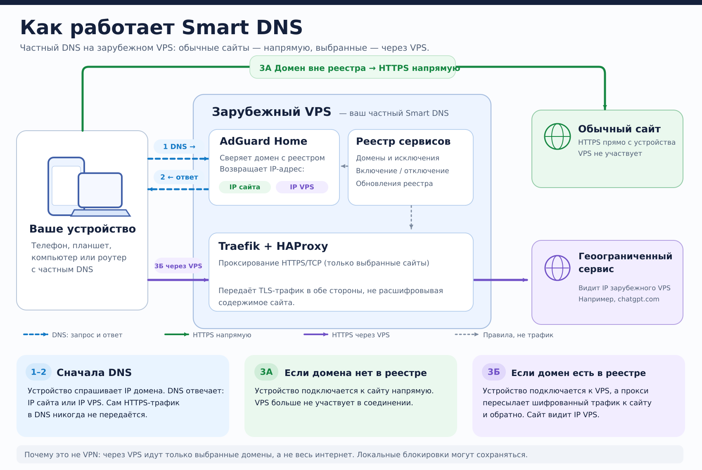

# Smart DNS

**Частный Smart DNS для ресурсов с геоограничениями.** Для доменов из управляемого GEO-каталога система направляет поддерживаемые HTTPS/TCP-соединения через зарубежный VPS. Остальные сайты открываются напрямую. Постоянно включённый VPN на устройстве не нужен.

## Как это работает

Сначала устройство спрашивает у нашего DNS адрес сайта. **Только после ответа DNS** оно устанавливает соединение — либо с обычным сайтом, либо с зарубежным VPS. На диаграмме показаны оба сценария.



[Открыть схему в векторном формате (SVG)](docs/assets/smart-dns-flow.svg).


**Легенда:**

- **Устройство / роутер** — твой телефон, компьютер или домашний роутер. Оно инициирует DNS-запрос и следующее соединение; при DNS на роутере обращения домашних устройств могут сначала идти к роутеру.
- **Зарубежный VPS** — наш сервер. **AdGuard Home** выбирает DNS-ответ; **Traefik** принимает выбранные HTTPS/TCP-соединения на общем входе VPS; **HAProxy** передаёт их конечному сайту.
- **Обычный сайт** — устройство соединяется с ним напрямую **после того, как DNS вернул настоящий IP**. DNS-запрос при этом всё равно обслужил наш сервер.
- **GEO-сайт** — устройство соединяется с **VPS**, поскольку DNS вернул IP VPS. Сервер пересылает разрешённый TCP/TLS-трафик сайту; сайт видит IP VPS.
- **GEO-каталог** — готовые обновляемые реестры плюс наши включения и исключения. Согласованная политика применяется к DNS, Traefik и HAProxy; каталог не передаёт пользовательские данные.

> Диаграмма показывает логику выбора маршрута. Фактически DoH-запрос проходит через Traefik к AdGuard Home, а DoT — через HAProxy к AdGuard Home. Это отдельный DNS-трафик, не путь загрузки страниц.

### Почему это не VPN и не универсальный обход блокировок

**Не VPN.** Устройство не создаёт отдельный сетевой туннель. DNS выбирает, к какому IP подключиться: обычные сайты — напрямую, выбранные GEO-сайты — через VPS. TLS-шифрование остаётся сквозным между клиентом и конечным сайтом: VPS пересылает соединение, но не расшифровывает HTTPS. При этом **весь трафик поддерживаемого соединения**, включая скачивание файлов, действительно проходит через канал VPS.

**Не гарантия обхода блокировок внутри России.** Мы прежде всего решаем другую задачу: зарубежный ресурс ограничивает посетителей по стране их IP. Российский провайдер может блокировать IP, SNI, протоколы или само соединение с VPS. Smart DNS не скрывает SNI и не создаёт VPN-туннель; поэтому доступ к ресурсам, заблокированным российскими сетями, **не гарантируется**. Некоторые из них могут работать через доступный VPS, но это не универсальная функция системы.

**Другие ограничения:** собственный DNS приложений, QUIC/HTTP/3, ECH и кеши могут обходить описанный TCP-маршрут. Сайт также может проверять страну аккаунта, платёжные данные или IP/ASN сервера. Персональный ClientID защищает DNS-доступ, но не служит паролем для последующего TLS Relay — направления Relay ограничены правилами.

## Из чего собран проект и почему

| Компонент | Зачем используем |
| --- | --- |
| **AdGuard Home** | Готовый DNS с DoH/DoT, управлением клиентами и правилами. Не пишем собственный DNS-сервер. |
| **Traefik** | Уже обслуживает HTTPS на VPS: сохраняем один общий вход вместо второго конкурирующего сервера на порту 443. |
| **HAProxy** | Готовая передача TLS по SNI, разрешение адресов конечных серверов и ограничения соединений без расшифровки HTTPS. |
| **GEO-реестры** | Используем поддерживаемые сообществом списки вместо ручного перечня всех сайтов; сохраняем свои исключения. |
| **Небольшие Python-адаптеры + GitHub Actions/systemd** | Из одного каталога формируем согласованные правила, проверяем фактическое состояние, обновляем источники и поддерживаем откат без отдельной платформы управления. |
| **Certbot + acme-dns** | Штатный выпуск и продление сертификатов DoT через DNS-01. |

**Почему не один «универсальный прокси»?** Связка использует штатные возможности уже работающего VPS и готовых компонентов. Собственный код отвечает только за согласование правил и жизненный цикл изменений. Общий Traefik принадлежит платформе VPS; Smart DNS должен оставаться отключаемым без изменений Hermes и соседних сервисов.

## Управление

На рабочем VPS используется единая команда `smart-dns`. Примеры:

```sh
smart-dns status
smart-dns list
smart-dns show community-geo
smart-dns off chatgpt --reason 'Временно выключено'
smart-dns on chatgpt --reason 'Включено владельцем'
smart-dns exclude example.org --reason 'Оставить прямой доступ'
smart-dns refresh
```

`list` и `show` показывают каталог и желаемую политику, **не** доказательство фактической маршрутизации. `status` сверяет текущие native-правила; работа конкретного приложения проверяется отдельно. Существуют также команды `add`, `include`, `apply` и `rollback`. Изменения GEO-реестров обновляются штатным заданием в разрешённых границах; расширение области охвата и рискованные изменения требуют проверки. **Обновление программных компонентов автоматически не выполняется.**

**Где хранятся данные:** публичные `rules/` в Git — пример/исходная кодовая база, а не копия всей активной политики. Рабочие GEO-правила, ClientID, клиентские исключения и секреты находятся в приватной конфигурации VPS. Не переносите их в публичные issue, PR и логи.

## Документация

- [**Действующая установка: компоненты, источники истины, обновления и восстановление**](docs/operations.md) — основная техническая точка входа.
- [Продуктовая цель и остающиеся проверки](docs/product-goal.md) · [GOAL #12](https://github.com/Kwentin3/smart-dns/issues/12).
- [Почему проект вырос из изолированного пилота](docs/refactor.md) · [Приёмка широкого GEO-профиля](docs/reports/2026-11-07/production-fancy-rollout.md). Это история решений, а не инструкция для новой установки.

Прошлые исследования, лабораторные отчёты и протоколы проверок сохранены в `docs/` и истории Git, но не дублируются в README.
